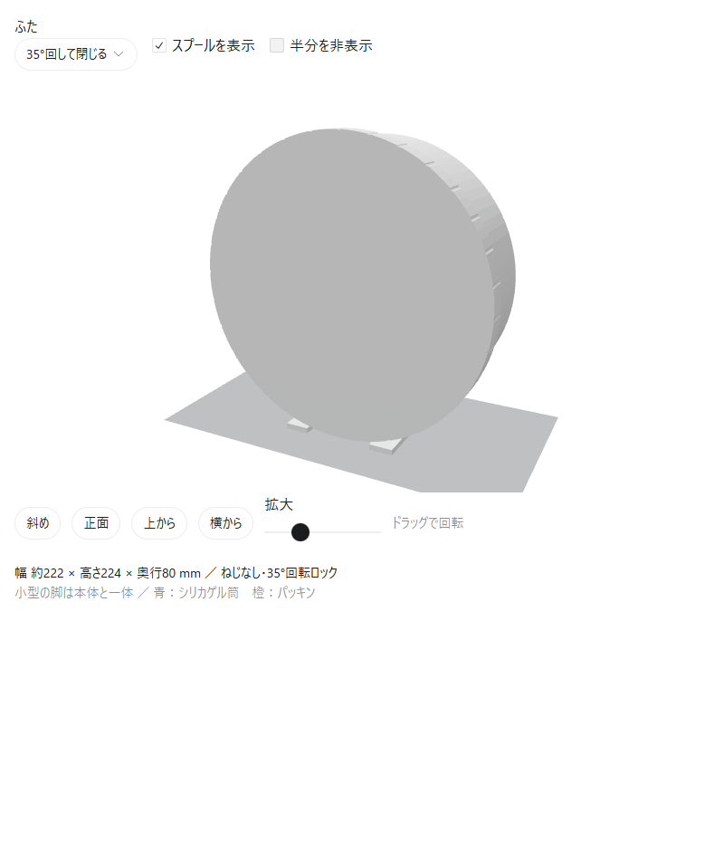

# Bambu Spool Drybox

Bambu Labのフィラメントスプールを1巻収納する、縦置きできる防湿ケースの試作CADです。Bambu Lab A1で造形できるサイズで、build123dを使って設計しています。



## 設計

- 外形：約 **幅222 × 高さ224 × 奥行80 mm**
- 収納対象：外径200 × 幅67 mmのスプール（中心穴55 mmを仮定）
- 本体と一体の小型脚で自立
- 約35°回転して開閉する、工具・金属ねじ不要のバヨネット式ふた
- 中央に通気スリット付きのシリカゲル収納筒
- 外周にシリコーンOリングを配置

**未造形の試作設計です。** CAD上の部品干渉とSTLの形状は確認済みですが、実物の開閉の固さ・耐久性・密閉性は未検証です。

## CAD・造形データ

| ファイル | 内容 |
| --- | --- |
| [case_standing.step](case_standing.step) | 自立した状態の組み立てCAD |
| [case_assembly.step](case_assembly.step) | 設計座標での組み立てCAD |
| [body.step](body.step) / [lid.step](lid.step) | 本体・ふたの個別CAD |
| [body.stl](body.stl) / [lid.stl](lid.stl) | 造形向きに配置したSTL |
| [filament_case.py](filament_case.py) | 寸法を変更できる設計コード |
| [validation.json](validation.json) | 形状・干渉・STLなどの検証結果 |
| [README.txt](README.txt) | 詳細寸法、部品、組み立て、造形時の注意 |

本体とふたは別々のプレートで造形します。シリカゲルは通気性のある小袋に入れ、中央筒へ収めてください。パッキンは内径206 mm・線径2 mmのシリコーンOリングを想定しています。

## CADの再生成

Python 3.12以降を使用します。

```sh
python -m venv .venv
```

Windows PowerShell：

```powershell
.\.venv\Scripts\python.exe -m pip install -r requirements.txt
.\.venv\Scripts\python.exe filament_case.py
```

macOS / Linux：

```sh
.venv/bin/python -m pip install -r requirements.txt
.venv/bin/python filament_case.py
```

生成したSTEP・STLはこのフォルダーのファイルを更新します。`validation.json`内のSTLメッシュ検査結果は、別途trimeshで確認した保存時点の記録です。設計スクリプトの再実行時にはCAD形状・干渉・重心の検査結果が書き出されます。

## 履歴

`design-v2` タグは、小型脚と回転式ふたを備えた初回保存の設計を指します。寸法を変更するときは、設計コードと再生成したCADをまとめてコミットします。
